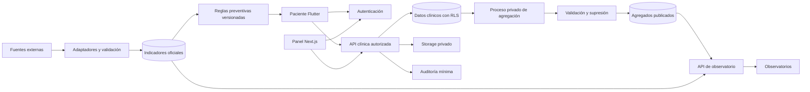
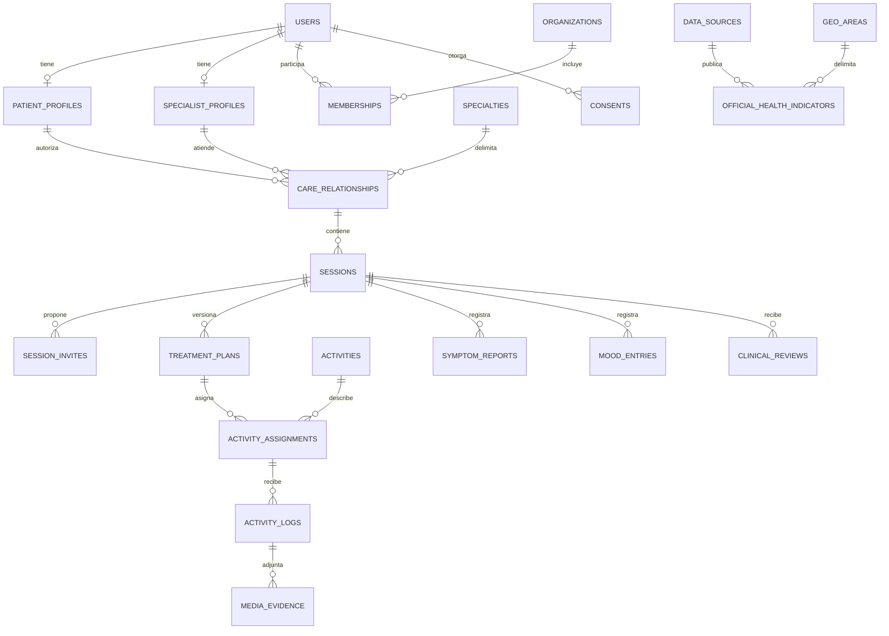

# Med Box — Especificación inicial y plan de ejecución

## 0. ESTADO ACTUAL (leer esto primero)

Actualizado: 17/11/2026. Esta sección resume lo construido. Si basta para la tarea pedida, no hace falta leer el resto: las secciones 1–11 son la especificación original y su historia, y donde contradicen esta sección manda esta.

### Decisiones del equipo que cambian el plan original
- **Fisioterapeuta → panel web** (`apps/panel_web`). **Paciente → app móvil** (`apps/paciente_flutter`), que es solo para pacientes; si entra una cuenta profesional, la app la manda al panel.
- **Fisioterapia es la especialidad activa.** Las otras tres solo tienen registro básico.
- **Conteo por cámara y evaluación del patrón del ejercicio: ya están DENTRO del alcance** (el plan original los dejaba fuera del MVP). Se presentan como «estimación automática», no como diagnóstico.
- **No mostrar textos de «ficticio», «prototipo» o «demo»** en la interfaz. El modo sin cuenta se llama «Explorar sin cuenta».
- **El fisio se autorregistra** con cédula. Su cuenta queda «pendiente de verificación» y él no puede verificarse solo; el autorregistro se cierra en `public.app_settings`.
- **Giro a SaaS doctor–paciente (17/11/2026):** el foco es la experiencia del especialista (cliente que paga) y sus pacientes. Observatorio estacional y farmacias se ocultan tras una bandera (código intacto, para otro producto). Marca Med Box fuerte; estilo «clínico premium limpio» (mucho blanco, tipografía fuerte, acento por especialidad). Prioridad: **fisioterapia + dermatología**; psicología y oftalmología heredan el sistema de diseño después. Panel: dashboard de inicio, expediente/progreso con gráficas, agenda y citas, configuración del consultorio. App paciente en 4 pestañas: Hoy (plan + racha) · Progreso · Mensajes · Perfil, con campana de notificaciones. Sin cobro/suscripción por ahora. Proceso: mockups aprobados antes de tocar código.
- **Panel del doctor y app del paciente deben coincidir siempre** (regla del equipo, 17/11/2026): mismos datos de las mismas tablas, mismo estado visible en ambos lados (p. ej. un envío «en revisión» en la app = «por revisar» en el panel; la cita que ve el paciente = la del bloque en la agenda), mismas métricas y escalas (dolor 0–10 por envío, cumplimiento por semana), mismos nombres de ejercicios y mismo sistema visual (tokens Med Box, acento por especialidad, Manrope + Inter). Mockups aprobados: https://claude.ai/artifact/TjSE5NBanyG1ARLFuyT3Fa
- **Agenda automática + asistente de citas (diseño, 17/11/2026; sin implementar):** adaptación del prompt de referencia (Express/FastAPI + cal.com) al stack actual, sin backend nuevo:
  - Motor de citas en Supabase Postgres: `availability_rules` (horario semanal del especialista, duración, servicio), `availability_exceptions` (vacaciones/bloqueos) y `appointments` con restricción de exclusión (`tstzrange` + `btree_gist`) que impide dobles reservas. RPC `get_available_slots` y `book_appointment` / `reschedule_appointment` / `cancel_appointment` `SECURITY DEFINER` con escritura en `access_audit`. El «tenant» es el especialista de la sesión activa (no se recibe `tenant_id` del cliente; se deduce del JWT y de la sesión).
  - Confirmación **automática** si el bloque está abierto; el doctor puede cancelar después con aviso al paciente.
  - Asistente: Edge Function `chat-agent` (Deno/TS) con **Gemini** y function calling. Herramientas: `check_availability`, `book_appointment`, `reschedule_appointment`, `cancel_appointment`, `list_my_appointments`. Las herramientas llaman a las RPC con el JWT del paciente (RLS manda). Alcance: solo agendar/reagendar/cancelar y recordatorios; nada clínico (si el paciente pregunta algo clínico, lo remite a su especialista). Prompt de sistema: nunca inventar horarios, consultar disponibilidad antes de reservar, confirmar datos antes de reservar. Al pulsar un chip de horario la app llama directo a `book_appointment` sin pasar por el LLM (más barato y seguro). Historial por conversación en tabla `chat_messages` con RLS. Datos mínimos al LLM (sin expediente).
  - Contrato de respuesta: `{ reply_text, action_type: NONE|SHOW_SLOTS|BOOKING_CONFIRMED, available_slots[], booking_details }`.
  - Recordatorios: `pg_cron` + notificaciones push (FCM) para cita y ejercicios pendientes.
  - Panel: vista Agenda (semana/día), editor de horario disponible y lista de citas.
  - La llave de Gemini vive solo como secreto de Edge Function (`GEMINI_API_KEY`); nunca en la app, el panel ni el repositorio.
- **Reutilizar código de `references/`** cuando la licencia lo permite: PhysioBuddy y fisio-app son MIT. MedAssist (propietario), COPE (GPL) y smart-sleeve (AGPL) solo como ideas. Atribuciones en `docs/REFERENCIAS_DESCARGADAS.md`.

### Infraestructura
- **Supabase:** proyecto `vdfqadtohwlolwuwgeki`. Las apps usan solo la clave publicable (`apps/paciente_flutter/lib/config.dart` y `apps/panel_web/src/lib/supabase.ts`).
- **Migraciones aplicadas** (`supabase/migrations`), en este orden:
  - `0001`: sesiones, registros, invitaciones y `request_care_link`;
  - `0002`: perfiles, organización, especialistas, actividades, revisiones, consentimientos, solicitudes de datos, auditoría, catálogo preventivo y almacenamiento `care-evidence`;
  - `0003`: autorregistro del fisio, catálogo de 5 ejercicios, métricas de ejercicio, dolor posterior y video;
  - `0004`: ejercicios propios del fisio con video demostrativo (almacenamiento `exercise-demos`);
  - `0005`: expediente profesional `clinical_notes` (piel y mente, solo lectura/inserción del especialista de la sesión activa) e imágenes clínicas del especialista con consentimiento de imágenes;
  - `0006`: los ejercicios físicos y repeticiones solo se asignan en sesiones de fisioterapia (aplicadas 17/11/2026);
  - `0007`: expediente profesional también en fisioterapia y oftalmología (aplicada 17/11/2026);
  - `0008`: agenda: `scheduling_settings`, `availability_rules` (día ISO 1–7), `availability_exceptions`, `appointments` (exclusión gist contra dobles reservas; escritura solo por RPC) y RPC `get_available_slots`, `book_appointment`, `cancel_appointment`, `reschedule_appointment`, `confirm_appointment`, `close_appointment` (aplicada 17/11/2026; prueba `supabase/tests/agenda_smoke.sql` → `AGENDA OK`).
- **No hay CLI ni psql locales.** Las migraciones se aplican en el SQL Editor del dashboard; con el navegador integrado se inserta el SQL en Monaco mediante `window.monaco.editor.getModels()[0].setValue(...)`.
- **Pruebas SQL** (transacción con rollback, no dejan datos): `supabase/tests/rls_smoke.sql` → `RLS OK`; `supabase/tests/physio_smoke.sql` → `FISIO OK`.
- **Seguridad:**
  - RLS deniega por defecto.
  - El paciente ve solo lo suyo.
  - El especialista ve solo sus sesiones activas; al cerrar una sesión pierde el acceso y el paciente conserva su historial.
  - Lo que cambia accesos (invitar, aprobar, rechazar, cerrar, autorregistrarse) pasa por funciones `SECURITY DEFINER` que escriben en `access_audit`.
  - Las invitaciones son de un solo uso, duran 48 h y están ligadas al correo.
  - Los archivos son privados y se ven con URL firmada.

### Flujo funcionando de punta a punta (verificado con cuentas reales)
1. **Web `/registro`:** el fisio crea su cuenta y su perfil profesional.
2. **Web `/invitar`:** genera el código y lo envía por WhatsApp o correo.
3. **App:** el paciente se registra con ese correo y usa «Vincular con un código».
4. **Web `/panel`:** el fisio aprueba la solicitud y se crea la sesión privada.
5. **Web `/ejercicios`:** el fisio crea ejercicios propios (instrucciones, video demostrativo y patrón de conteo opcional).
6. **Web `/paciente?id=`:** el fisio asigna ejercicios (repeticiones, series, fecha) y aparecen en la sesión del paciente.
7. **App:** «Ver demostración y grabar» abre una animación propia del movimiento y/o el video del fisio, más instrucciones. Luego la grabación cuenta repeticiones en vivo con ML Kit Pose y evalúa el patrón.
8. **App:** el paciente envía video y métricas, con progreso real de subida y animación al terminar.
9. **Web:** el fisio ve métricas, video y nota, y deja una revisión que el paciente lee en la app.

### Mapa de código
- **App** (`apps/paciente_flutter/lib`):
  - `data.dart`: repositorio Supabase, modo exploración y subida con progreso;
  - `screens.dart`: pantallas del paciente;
  - `specialty_screen.dart`: inicio de cada sesión con el mismo diseño para las 4 especialidades (Información general, plan, progreso, Sesiones y Notificaciones); colores y textos por especialidad en `_Look`. Piel usa seguimiento fotográfico; fisio, gráfica de dolor y botón «Ver demostración y grabar»; mente, frecuencia de emociones;
  - `exercise_analysis.dart`: 5 detectores portados de PhysioBuddy (curl de bíceps, cuádriceps, hombros, sentadilla, elevación de rodilla) más métricas;
  - `exercise_demo.dart`: animación de demostración;
  - `exercise_capture.dart`: cámara, conteo en vivo, resultado y envío;
  - `territory.dart`: observatorio estacional: 4 macro-zonas (`assets/geo/cancun_macrozonas.geojson`, delimitación aproximada), catálogo de padecimientos por temporada (`assets/geo/perfil_estacional.json`, perfil estatal de los Anuarios de Morbilidad de la DGE) y alertas C01–C04 calculadas con el clima real de Open-Meteo (sin token, con caché de sesión);
  - `pharmacies.dart`: farmacias con respaldo DENUE (si hay `--dart-define=INEGI_DENUE_TOKEN`) → Overpass/OpenStreetMap → última consulta → copia local `assets/geo/farmacias_respaldo.json` (40 farmacias reales de OSM, ODbL, 18/11/2026);
  - `territory_screens.dart` (pestaña Prevención) y `pharmacies_screen.dart` (búsqueda por zona/cadena o ubicación consentida y redondeada); `public_info_widgets.dart` con piezas compartidas;
  - `config.dart`: datos públicos de Supabase.
- **Panel** (`apps/panel_web`, Next.js 15 con exportación estática y Tailwind; base de UI de fisio-app): `src/components/specialty-workspace.tsx` (expediente del paciente con el mismo diseño para las 4 especialidades: Inicio, Información general, plan, progreso, Sesiones y, en piel/mente, notas clínicas de `clinical_notes`; paleta por `data-specialty` en `globals.css`; vista previa sin cuenta en `/vista-clinica`), `src/lib/data.ts` (consultas y RPC), `src/lib/use-specialist.tsx` (control de acceso en el cliente; la seguridad real es RLS) y las páginas en `src/app/(app)/{panel,invitar,pacientes,paciente,ejercicios}` y `src/app/(auth)/{login,registro}`.
- **Pruebas:**
  - app: `flutter test` (31 aprobadas), incluido el analizador con poses sintéticas y la animación que alcanza los umbrales;
  - panel: `npx tsc --noEmit` y `npx next build`.

### Cómo correr y verificar
- **Panel:** `npm --prefix apps/panel_web run dev` (puerto 3000; también configurado en `.claude/launch.json` como `panel-web`).
- **App en el teléfono:**
  - dispositivo Android CPH2689 por adb (`%LOCALAPPDATA%\Android\Sdk\platform-tools\adb.exe`, serie `YP7589ZXG66LCY89`, paquete `mx.medbox.med_box`);
  - compilar con `flutter build apk --debug --no-pub` e instalar con `adb install -r build/app/outputs/flutter-apk/app-debug.apk`;
  - en Git Bash usar `MSYS_NO_PATHCONV=1`; el teléfono se desconecta seguido.

### Notas técnicas importantes
- **Vista previa de la cámara:**
  - Al iniciar la grabación, CameraX re-vincula los casos de uso (preview + análisis + video) y la vista se giraba o estiraba.
  - Solución actual en `_preview()` de `exercise_capture.dart`: recorte fijo de pantalla completa, preset `high` (16:9) y bitrate de 2.5 Mbps. Antes de grabar: `buildPreview()` con un `RotatedBox` que devuelve el giro de la orientación física. Durante la grabación: la `Texture` directa.
  - El equipo lo aprobó a simple vista en el teléfono. Si vuelve a fallar, revisar ahí primero.
- **Datos de ejercicio:** la actividad trae `exercise_code` y el detector sale de `exercise_catalog.detector`. Sin detector, el ejercicio es «solo video».

### Pendiente o siguiente
- Las 4 especialidades ya tienen diseño propio en app y panel (17/11/2026). Las 4 tienen expediente profesional en `clinical_notes`; fisio y ojos vía la migración `0007`. La app del paciente solo muestra sesiones activas: al cerrarla el especialista, sale del inicio del paciente (los datos se conservan).
- Panel rediseñado (17/11/2026) según los mockups: tokens Med Box + Manrope/Inter, sidebar nuevo, inicio con «Citas hoy» reales, «Por revisar», cumplimiento semanal y «Necesitan atención»; expediente con barras de cumplimiento (6 semanas) y línea de dolor; `/agenda` (`src/lib/agenda.ts`: semana/día, nueva cita con huecos reales, confirmar/cancelar/atendida, horario, ajustes y bloqueos) y `/consultorio` (perfil). Pestaña «Citas» del expediente lee `appointments`.
- Falta en el panel: login/registro con el nuevo diseño, verificación de cédulas desde una interfaz de administrador, y probar la agenda con una cuenta real.
- Falta en la app: pestañas Hoy/Progreso/Mensajes/Perfil, agenda del paciente y Edge Function `chat-agent` (Gemini).
- Observatorio estacional y farmacias: construidos en la app. Falta: validación editorial del catálogo de padecimientos contra las cifras del anuario, capa oficial del INEGI para las zonas, token DENUE (idealmente vía Edge Function) y versión web del observatorio.
- iOS sin validar.
- Ver la sección 10 para el backlog original.

---

Fecha: 17 de noviembre de 2026. Idioma: español de México. Estado original: planificación. Actualización: el equipo autorizó iniciar código; existe una primera implementación móvil en `apps/paciente_flutter`.

Este documento incorpora las correcciones del equipo al contexto original: nombre **Med Box** y cuatro especialidades: **fisioterapia, dermatología, oftalmología y psicología**. Las decisiones indicadas como propuestas son valores de partida, no funciones existentes ni decisiones clínicas validadas.

## 1. Diagnóstico y resumen ejecutivo

Se inspeccionó `C:\Users\jonis\OneDrive\Escritorio\TucaTon`: estaba vacía, sin `.git`, `AGENTS.md`, aplicaciones, manifiestos o documentación previa. No hay implementación que conservar o migrar. No se inicializó Git ni se instalaron dependencias.

Med Box ayudará a mantener el seguimiento entre consultas mediante sesiones privadas, actividades y registros que revisa el especialista. Una segunda superficie ofrecerá prevención territorial y un observatorio con fuentes oficiales y métricas simuladas claramente separadas durante el hackathon.

El diferenciador propuesto para «Del Dato al Impacto» es demostrar la cadena completa: indicación profesional → registro del paciente → revisión del progreso → información preventiva territorial explicable. La información clínica individual no se convierte automáticamente en información pública.

Piloto: Cancún / Benito Juárez, Quintana Roo. Usuarios y registros del prototipo: exclusivamente sintéticos. Supuesto de diseño: pacientes adultos, una organización de demostración y un especialista ficticio por especialidad. Menores y tutores requieren un flujo posterior específico.

### Alcance inicial propuesto

| Especialidad | Recorrido básico P0 | Fuera del MVP |
|---|---|---|
| Fisioterapia | Rutina asignada, series/repeticiones, cumplimiento, dolor reportado 0–10, comentario y revisión | Conteo mediante cámara, corrección automática de postura |
| Dermatología | Foto ficticia privada, zona corporal, síntomas reportados y comparación por fecha | Clasificación diagnóstica de lesiones |
| Oftalmología | Indicaciones del profesional, actividad de seguimiento, molestias reportadas, lateralidad y control programado | Medición de agudeza visual desde pantalla, diagnóstico por cámara, recomendaciones farmacológicas generadas |
| Psicología | Actividad asignada, registro emocional opcional y comentario compartido con el profesional de esa sesión | Diagnóstico automatizado, puntuación de riesgo, cuestionarios clínicos sin revisión, vigilancia de crisis en tiempo real |

Psicología forma parte del alcance inicial; sus funciones avanzadas quedan para etapas posteriores. El registro emocional compartido debe identificarse como tal antes de enviarse. No se presenta como diario privado ni como canal de atención inmediata.

## 2. Auditoría documental de referencias

Método: revisión de páginas públicas, README, árboles visibles y manifiestos accesibles. No se ejecutaron aplicaciones, pruebas o análisis de vulnerabilidades. Las páginas consultadas pueden provenir de caché; no se obtuvo un SHA inmutable. La consulta directa a la API de GitHub falló por resolución de host en la terminal. Varios archivos individuales devolvieron `Cache miss` en navegación. Por ello esta es una auditoría documental inicial, no una certificación funcional o de seguridad.

Los nombres de carpetas y afirmaciones del README no prueban funcionamiento. No hay evidencia suficiente para afirmar mantenimiento activo de ninguno: faltan fechas verificadas del último commit y resultados recientes de CI. Los recuentos siguientes son los mostrados en las páginas consultadas, no una medida de calidad.

| Referencia y problema | Stack y estructura observados | Licencia y mantenimiento observado | Patrón aprovechable y decisión |
|---|---|---|---|
| [MedAssist-AI](https://github.com/ADG1411/MedAssist-AI): conexión paciente/profesional | README declara Flutter, React/Vite y Supabase; raíz con `Patient`, `doctorportel`, `MedAssist-RN`, `Admin`, `supabase`. Manifiestos no recuperados | README declara propietario, todos los derechos reservados. 113 commits visibles; fecha reciente no verificada | Adaptar conceptualmente separación móvil/web y organización por funcionalidades. No copiar código. La convivencia de varios clientes requiere aclaración; no adoptar sus funciones diagnósticas ni secretos de proveedor en cliente |
| [PhysioBuddy](https://github.com/onkar0127/PhysioBuddy): ejercicios y cumplimiento | `frontend`/`backend`; React 19, Vite 7 y Tailwind 3 confirmados en manifiesto frontend. Django/Channels, MediaPipe y SQLite declarados en README; dependencias backend pendientes | MIT identificada por GitHub; 191 commits visibles. Texto íntegro de licencia pendiente antes de cualquier reutilización | Adaptar catálogo → asignación → estado del paciente. Descartar pose tracking para P0. README reconoce almacenamiento base64 y canal en memoria: no trasladar esos patrones |
| [fisio-app](https://github.com/Mrcipo/fisio-app): expediente, plan y evolución | `apps`, `docs`; manifiesto frontend confirma Next 15, React 18, Recharts y Zod. Express/Prisma/PostgreSQL declarados en README | MIT identificada por GitHub; 16 commits visibles. README declara 61 pruebas con mocks; no ejecutadas | Adaptar historial por sesión, objetivos y gráfica. No asumir que su aislamiento por propietario resuelve equipos y relaciones clínicas de Med Box; no trasladar afirmaciones legales de retención |
| [skin-care-connect](https://github.com/Andrewkimutai/skin-care-connect): triaje de imágenes y citas | README declara Streamlit y ResNet50; árbol con `src`, `models`, `training`, `sample_images`. `requirements.txt` visible pero contenido no recuperado | MIT identificada por GitHub; 7 commits visibles. Se describe como prototipo académico | Adaptar conceptualmente carga e historial. Descartar clasificador. No se verificó comparación longitudinal ni aislamiento clínico suficiente; historial de análisis no equivale a seguimiento clínico |
| [COPE](https://github.com/sudoshi/COPE): seguimiento de bienestar | README declara Fastify, React/Vite, React Native/Expo, PostgreSQL/Redis; raíz `apps`, `packages`, `docs`. Manifiestos no recuperados | GPL-3.0 identificada por GitHub; 92 commits visibles. README informa transición de clientes móviles | Adaptar registro diario y revisión de tendencias mediante implementación propia. No copiar escalas, puntuaciones o alertas. Alcance clínico y migración de clientes exceden el hackathon |
| [smart-sleeve-app](https://github.com/Concordia-Biomedical-Engineering-Club/smart-sleeve-app): rehabilitación con telemetría | README declara React Native/Expo, Next.js, Firebase y SQLite; carpetas móvil, `clinician-portal`, `backend`, `ml`. Manifiestos no recuperados | [LICENSE](https://github.com/Concordia-Biomedical-Engineering-Club/smart-sleeve-app/blob/main/LICENSE) contiene GNU AGPL v3. 56 commits visibles; proyecto se describe como educativo | Adaptar estados de sincronización y separación de superficies. Descartar BLE y telemetría. No adoptar código o dependencias sin revisar compatibilidad de licencia |

Manifiestos efectivamente leídos: [PhysioBuddy/frontend/package.json](https://raw.githubusercontent.com/onkar0127/PhysioBuddy/main/frontend/package.json), [fisio-app/apps/frontend/package.json](https://raw.githubusercontent.com/Mrcipo/fisio-app/master/apps/frontend/package.json).

Conclusión propia: construir el núcleo de Med Box con implementación original y reutilizar ideas de interacción, no ensamblar los seis proyectos. No hay referencia de oftalmología en esta lista: el módulo propuesto necesita revisión profesional propia. Una auditoría posterior de código, dependencias transitivas, licencias completas y CI será necesaria únicamente si se decide incorporar material concreto de terceros.

## 3. PRD: roles, historias y aceptación

### Permisos

| Rol | Puede | No puede |
|---|---|---|
| Paciente | Consultar sus sesiones autorizadas; enviar registros propios; controlar consentimientos | Leer otros pacientes, autoaprobar vínculos o editar valoraciones profesionales |
| Especialista | Crear programas, aprobar vínculos, asignar y revisar en su ámbito autorizado | Consultar pacientes de colegas o de otra especialidad por pertenecer a la misma organización |
| Administrador de organización | Gestionar miembros, especialidades y estado de credenciales | Obtener acceso clínico por su rol administrativo |
| Visitante | Consultar indicadores publicados y metodología | Consultar tablas clínicas o aplicar filtros individuales |
| Analista institucional | Consultar agregados aprobados y exportaciones permitidas | Navegar del agregado al expediente o reconstruir cohortes pequeñas |
| Administrador de plataforma | Configurar integraciones y consultar eventos técnicos mínimos | Disponer de una interfaz de lectura indiscriminada de expedientes |

El rol elegido en registro no concede privilegios profesionales. En el demo, especialistas y analistas se provisionan como cuentas sintéticas. La verificación de credenciales para uso real es un proceso posterior, nunca una insignia ficticia presentada como verificación real.

### Historias verificables

| ID | Historia | Criterios de aceptación |
|---|---|---|
| U01 | Como paciente quiero entrar a mi cuenta | Sesión autenticada; cierre elimina estado sensible; un usuario anónimo no obtiene expedientes |
| U02 | Como especialista quiero invitar a un paciente | Código aleatorio con vencimiento y revocación; se muestra solo al emitirlo; validación en servidor; nunca contiene identificadores clínicos |
| U03 | Como paciente quiero solicitar un vínculo | Código válido crea solicitud pendiente; no expone datos de otros integrantes; duplicados no crean relaciones adicionales |
| U04 | Como especialista quiero aprobar solicitudes | Se comprueba identidad de cuenta y destinatario; solo el responsable puede aprobar; vencimiento/revocación impide nuevas solicitudes |
| U05 | Como paciente quiero conservar mis sesiones | Tras aprobación aparecen sin volver a ingresar código; cada sesión indica especialidad, profesional y estado |
| U06 | Como fisioterapeuta quiero revisar ejecución | Actividad con vencimiento y metas; registro manual con fecha; dolor acepta 0–10 o ausencia explícita; un reintento no duplica cumplimiento |
| U07 | Como paciente de dermatología quiero aportar evidencia | Consentimiento previo; archivo permitido y tamaño validado; imagen privada; paciente ajeno no puede descargarla aunque conozca su identificador |
| U08 | Como paciente de oftalmología quiero registrar seguimiento | Lateralidad derecha/izquierda/ambos/no aplica y molestias subjetivas; ninguna medida se etiqueta como examen visual; el especialista revisa |
| U09 | Como paciente de psicología quiero compartir un registro | Emoción y nota opcionales; destinatario visible antes de enviar; sin puntuación diagnóstica; profesional de otra sesión no lo consulta |
| U10 | Como especialista quiero revisar progreso | Gráfica reproduce registros existentes; faltantes no son ceros; cada valoración conserva autor y fecha; correcciones quedan versionadas |
| U11 | Como ciudadano quiero entender datos territoriales | Fuente, periodo, zona, unidad, denominador cuando aplica y etiqueta oficial/simulado; dato faltante no aparece como cero |
| U12 | Como usuario quiero buscar atención cercana | Búsqueda manual funciona sin permiso GPS; resultados indican proveedor; sin afirmar disponibilidad de medicamentos |
| U13 | Como paciente quiero controlar usos adicionales | Consentimientos de fotos, ubicación y analítica separados; rechazar analítica no bloquea seguimiento; retiro registrado y aplicado a usos futuros |
| U14 | Como analista quiero consultar información segura | Solo cubos publicados; filtros permitidos; supresión consistente en pantalla y exportación; no endpoint de pacientes |
| U15 | Como especialista quiero un resumen asistido (P1) | Referencias a registros; marcado como borrador; revisión humana; si falla IA permanece disponible el historial y resumen determinista |

Objetivo de aceptación de P0: completar U01–U13 con datos sintéticos y demostrar un tablero institucional estático simulado; U14 avanzado y U15 pertenecen a P1.

## 4. Navegación y pantallas

Móvil: bienvenida → autenticación → Inicio / Mis sesiones / Prevención / Ajustes. Desde Inicio: especialidad → vincular → solicitud → sesión autorizada. Desde sesión: actividades, registro, historial y revisión. Todas las pantallas con carga, vacío, error recuperable y estado sin conexión explícitos.

| Pantalla móvil | Contenido y acción principal | Estados o límites |
|---|---|---|
| Bienvenida/acceso | Med Box, explicación breve, registro e inicio de sesión | Credenciales inválidas sin revelar existencia de cuenta; recuperación de acceso |
| Inicio | Cuatro especialidades y actividades próximas | Sin sesiones: mostrar vinculación; no tarjetas clínicas de terceros |
| Vincular | Código, explicación y envío de solicitud | Inválido, vencido, límite de intentos, pendiente, rechazado, aprobado |
| Mis sesiones | Profesional, especialidad, estado y siguiente actividad | Activa, pausada, cerrada; datos independientes por sesión |
| Detalle de sesión | Indicaciones, calendario simple, tareas e historial | Solo lectura al cerrar; cierre no borra registros |
| Actividad fisioterapia | Instrucciones aprobadas, metas y registrar ejecución | Video opcional con alternativa textual; no autogenerar ejercicios |
| Registro dermatología | Guía, foto sintética, zona y comentario | Vista previa, cancelar y reintentar; quitar metadatos de ubicación |
| Registro oftalmología | Indicaciones asignadas, lateralidad y reporte subjetivo | Sin pruebas de pantalla ni sugerencias clínicas autónomas |
| Registro psicología | Actividad, emoción opcional y texto a compartir | Explicar destinatario y ausencia de monitoreo continuo |
| Historial/progreso | Línea temporal, revisiones y gráfica específica | Sin inferir mejora clínica automáticamente |
| Prevención | Zona manual, fuente y tarjeta educativa | Distinguir educación de alerta local; mostrar dato vencido |
| Servicios cercanos | Consulta manual o ubicación consentida; listado | Sin resultados, proveedor caído y ejemplos simulados separados |
| Ajustes | Consentimientos, privacidad, solicitudes de exportación/eliminación | Estado de solicitud; no prometer eliminación inmediata de todo dato |

Web: acceso profesional → dashboard → pacientes → sesión → actividades/evidencias/revisión. Observatorio público en ruta separada sin login; institucional exige rol específico.

| Pantalla web | Contenido y acción | Comportamiento requerido |
|---|---|---|
| Dashboard | Pacientes asignados y pendientes de revisión | Métricas acotadas al profesional; sin diagnósticos inferidos |
| Pacientes | Búsqueda y solicitudes | Buscar solo dentro de relaciones permitidas |
| Crear programa | Especialidad, título, metas y actividades | Borrador antes de activar; versiones de indicaciones |
| Invitaciones | Emitir, vencer y revocar; aprobar solicitudes | Confirmación de aprobación y auditoría; no revelar códigos existentes |
| Sesión del paciente | Historial, registros y gráfica | Identidad y especialidad persistentes en encabezado |
| Revisar evidencia | Foto o registro, comentario y marcar revisado | Acceso validado en cada descarga; URL de corta duración |
| Organización/configuración | Miembros, credenciales y auditoría | Permisos administrativos separados de los clínicos |
| Observatorio público | Mapa municipal, indicador y metodología | Alternativa tabular accesible; no representar personas |
| Observatorio institucional | Comparación de periodos y filtros fijos | P0 simulado; P1 exportación auditada y supresión |

Diseño propuesto: fondos claros, contraste suficiente, texto legible y acciones descriptivas. No depender del color para dolor, emoción o alertas. Navegación con teclado, etiquetas para lector de pantalla, foco visible, texto ampliable y zonas táctiles cómodas. Los criterios se verifican con teclado, lector de pantalla y un teléfono Android de gama media durante implementación; no se declara conformidad WCAG sin evaluación.

## 5. Arquitectura y flujo de datos

Propuesta: Flutter/Dart para Android; Next.js/TypeScript para panel y observatorios; Supabase para autenticación, PostgreSQL y almacenamiento privado. Versiones exactas se elegirán y fijarán al implementar, tras comprobar compatibilidad vigente. No se fuerzan librerías compartidas entre Dart y TypeScript: compartir contratos documentados y ejemplos de payload.

La documentación de Supabase respalda el uso de [RLS](https://supabase.com/docs/guides/database/postgres/row-level-security) y [políticas de Storage](https://supabase.com/docs/guides/storage/security/access-control). Med Box deberá escribir y probar sus propias políticas; activar el servicio no garantiza aislamiento. Las claves privilegiadas permanecen exclusivamente en servidor.

En P0, el proceso de agregación se representa con fixtures sintéticos publicados y no procesa expedientes. En P1, worker privado produce snapshots revisados; la API pública no consulta tablas clínicas bajo demanda.

Operaciones críticas en servidor: consumo de invitaciones, aprobación, emisión de URLs, roles, auditoría, exportaciones y publicación de agregados. Transacciones para aprobar vínculos y consumir usos. UUID opaco no sustituye autorización. Idempotency key en envíos y cargas; sello de tiempo del servidor más fecha reportada.

Conexión intermitente: P0 conserva un borrador en memoria y permite reintentar, sin anunciar guardado hasta confirmación del servidor. No persistir expedientes en almacenamiento local sin cifrado. P1 puede agregar cola local cifrada y resolución de conflictos. Cerrar sesión limpia borradores.

Estructura futura: `apps/paciente_flutter`, `apps/panel_web`, `supabase`, `docs`, `data/sample`; `packages/contracts` solo si realmente simplifica los contratos. No crear microservicios para el hackathon.

## 6. Modelo de datos, consentimiento y seguridad

“Sesión” significa programa privado de seguimiento; una consulta o cita es un evento dentro del programa. Así no se confunde la sesión longitudinal con cada visita.

El vínculo es paciente + especialista + organización + especialidad, con estado solicitado/aprobado/revocado y fechas. Una plantilla de programa puede existir antes del vínculo; cada instancia clínica pertenece a un solo paciente. Nunca hay grupo de pacientes que comparta evidencias. Invitaciones apuntan a la plantilla o al destinatario pendiente; tras aprobación se crea la instancia individual.

| Grupo de tablas | Campos o reglas clave | Dueño, acceso y finalidad |
|---|---|---|
| users, patient_profiles, specialist_profiles | ID de Auth; perfil mínimo; estado profesional | Propio perfil; campos públicos profesionales separados de datos privados |
| organizations, memberships, specialties | Membresía y permisos asignados por servidor | Administración organizacional sin lectura clínica |
| care_relationships, sessions | Paciente, especialista, especialidad, estado | Participantes autorizados; continuidad asistencial |
| session_invites, join_requests | Hash/HMAC del código, expiración, límite de usos, destinatario y estado | Solo funciones servidor; vinculación controlada |
| treatment_plans, activities, activity_assignments | Versión, autor, instrucciones y vencimiento | Profesional escribe; paciente autorizado lee |
| activity_logs, symptom_reports | Fecha, autor, unidad, valores estructurados y comentario | Paciente envía; profesional vinculado lee; cambios trazables |
| ophthalmology_reports | Sesión, lateralidad, molestias reportadas, fecha | Mismo aislamiento por relación; no representa examen objetivo |
| mood_entries | Sesión, emoción declarada, nota compartida, versión de consentimiento | Solo paciente y profesional explícitamente vinculado a esa sesión |
| media_evidence | Objeto privado, MIME, tamaño, autor, fecha y consentimiento | Sin URL pública persistente; acceso por sesión |
| clinical_reviews | Autor, registro referido, texto, versión y fecha | Especialista escribe; paciente lee revisión compartida; notas internas requieren tabla y política separadas |
| consents, data_requests | Finalidad, texto/versionado, otorgamiento/retiro, estado de solicitud | Propio titular y operadores autorizados para tramitar |
| access_audit | Actor, recurso opaco, operación, resultado y tiempo | Lectura restringida; sin texto clínico ni imágenes |
| geo_areas, data_sources | Clave/versionado territorial; URL, fecha, licencia y cobertura | Catálogos publicados sin datos personales |
| official_health_indicators, population_indicators, environmental_indicators | Métrica, unidad, periodo, geografía, revisión, procedencia | Importación servidor; lectura publicada tras validar |
| public_health_aggregates | Cohorte fija, periodo, supresión y versión | Solo snapshots aprobados; sin IDs clínicos |
| prevention_rules, recommendation_events | Fuente, revisión, caducidad; evento mínimo | Regla publicada; eventos propios sin GPS preciso |

Todas las tablas mutables tienen ID, creación, actualización, actor y versión cuando proceda; datos clínicos incluyen organización y relación. Las FK y reglas de servidor impiden mezclar paciente, sesión y actividad de relaciones diferentes.

RLS conceptual: denegar por defecto; paciente por identidad y relación propia; especialista por relación vigente y especialidad; administradores sin excepción clínica automática. Lectura pública únicamente en vistas/snapshots de publicación. Revocar vínculo impide nuevas lecturas del profesional; cualquier retención o acceso clínico histórico para uso real requiere política expresa. El paciente conserva acceso a su información según el flujo de cuenta.

Invitaciones: propuesta de 12 caracteres aleatorios, expiración 48 horas, un uso y límite de intentos por cuenta/origen; comparar hash en servidor, no registrar código en logs. Usar invitaciones por paciente y aprobación explícita para evitar consumos indebidos. Revocar invitación no revoca vínculos previos: son acciones distintas.

Fotos: validar tamaño propuesto de 10 MB y formato JPEG/PNG; comprobar contenido, retirar EXIF, usar nombre opaco y almacenamiento privado. URLs firmadas propuestas de 60 segundos: una URL emitida puede seguir vigente hasta vencer; no prometer revocación instantánea. Eliminar caché sensible y no registrar URLs firmadas.

Consentimientos separados: seguimiento, imágenes, ubicación opcional, uso analítico opcional y eventual envío a IA. P0 no envía a proveedores de IA. Retiro de ubicación detiene nuevas lecturas; retiro analítico excluye nuevos snapshots y evalúa republicación. Un agregado ya publicado no permite prometer extracción individual automática.

Retención propuesta solo para demo: reiniciar registros sintéticos después de la demostración y eliminar el entorno a más tardar 30 días después del cierre; evidencias con el mismo ciclo, auditoría técnica hasta ese cierre ampliado. No es un plazo legal para expedientes reales. Antes de datos reales se deben definir responsable, aviso de privacidad, base de tratamiento, plazos aplicables, respaldos, contratos y trámite de derechos conforme al marco mexicano vigente. No se afirma cumplimiento legal en esta fase.

Privacidad analítica: P0 usa métricas sintéticas. P1 parte de cohortes municipales y periodos fijos, sin texto, fotos, ubicación exacta o identificadores. Umbral provisional k=10, junto con supresión complementaria, revisión de totales/restas, filtros cerrados, snapshots estables y restricción de exportaciones. k por sí solo no garantiza anonimato. Psicología y oftalmología no se publican por defecto desde registros de plataforma.

## 7. Fuentes e integraciones

Consultas documentales realizadas el 17/11/2026. No se consumieron endpoints autenticados ni se verificó un conjunto local de casos de dengue.

| Fuente | Acceso y granularidad verificados | Frecuencia, términos y fallback |
|---|---|---|
| [INEGI Indicadores](https://www.inegi.org.mx/servicios/api-indicadores/) | API JSON/XML y otros formatos; token requerido; geografía depende del indicador | Periodicidad y fecha según metadatos, no tiempo real. Verificar términos del indicador; snapshot oficial con fuente/periodo si falla. No aporta casos clínicos de usuarios |
| [INEGI Catálogo Único](https://www.inegi.org.mx/servicios/catalogounico/) | Servicios tabulares de claves territoriales y documentación GeoJSON; ejemplos sin token | Elegir edición compatible; descarga específica de Benito Juárez y licencia pendiente de validar. Fallback: capa oficial archivada y versionada; si no se consigue, tabla territorial sin polígono inventado |
| [Salud/DGE](https://www.gob.mx/salud/acciones-y-programas/informacion-epidemiologica) | Consulta bloqueada con HTTP 403; API, dataset y nivel municipal no verificados | Seleccionar publicación y periodo antes de integrar. Si solo hay estado, mostrar estado. Demo con cifras sintéticas; no atribuirlas a DGE ni presentar alertas vigentes |
| [SMN/CONAGUA](https://smn.conagua.gob.mx/es/) | Portal con lluvia, temperatura, pronósticos y reportes; API automatizable no confirmada | Cadencia y cobertura por producto. Licencia/formato pendientes. P0 puede omitir capa ambiental; no convertir lluvia simulada en riesgo sanitario real |
| [Google Places Nearby Search](https://developers.google.com/maps/documentation/places/web-service/nearby-search) | Búsqueda por área/tipo; API key y selección de campos; servicio sujeto a configuración y facturación | Consultar según necesidad; presupuesto/cuotas por configurar. Fallback: lugares ficticios rotulados; nunca inventario de medicamentos |
| [OMS: dengue](https://www.who.int/es/news-room/fact-sheets/detail/dengue-and-severe-dengue) | Fuente educativa para contenido preventivo general | Guardar URL y fecha de consulta, fecha de publicación cuando se extraiga y versión editorial. No implica alerta vigente en Cancún |

Las [políticas de Places](https://developers.google.com/maps/documentation/places/web-service/policies) exigen condiciones de atribución, restringen almacenamiento y establecen que sus resultados sobre mapa se muestren en Google Maps. Decisión: Leaflet solo para el observatorio; Places en listado separado con atribución o mapa Google. No colocar sus resultados en Leaflet ni aplicarles la caché genérica de indicadores.

Contrato conceptual de indicadores: fuente, indicador, definición, valor nullable, unidad, numerador/denominador cuando aplique, periodo inicial/final, clave y edición geográfica, fecha de publicación, fecha de consulta, licencia, revisión y estado oficial/sintético/no disponible. Rechazar duplicados de la misma revisión, unidades incompatibles y valores imposibles. Las correcciones oficiales sustituyen la revisión visible conservando procedencia.

## 8. Indicadores y fórmulas

| Indicador | Definición | Reglas |
|---|---|---|
| Cumplimiento | 100 × asignaciones vencidas completadas / asignaciones vencidas elegibles del periodo | Excluir canceladas antes del vencimiento; no contar futuras; deduplicar; denominador cero = sin datos; distinguir completada tarde |
| Cumplimiento a tiempo | 100 × asignaciones completadas antes o al vencer / elegibles vencidas | Fecha de confirmación servidor y fecha declarada diferenciadas |
| Cambio de dolor reportado | Último valor válido − primer valor válido dentro de la misma sesión/periodo | Requiere al menos dos mediciones; negativo indica menor reporte, no prueba de recuperación |
| Pendientes de revisión | Registros enviados sin revisión vigente | Una corrección reabre revisión; no sumar borradores |
| Participación | Pacientes con al menos un registro / pacientes con sesión activa en periodo | Describir población de usuarios; no extrapolar al municipio |
| Registro emocional | Serie temporal individual de categorías/escala definida | Sin índice de riesgo, diagnóstico ni comparación entre pacientes |
| Seguimiento oftalmológico | Actividades completadas y reportes por fecha/lateralidad | No producir agudeza visual ni inferir evolución de enfermedad |
| Casos oficiales | Valor publicado por fuente para su definición/periodo | No sumar reportes subjetivos o casos duplicados de usuarios |
| Incidencia acumulada | Casos nuevos definidos / población en riesgo compatible × factor indicado | Solo si fuente, periodo y denominador permiten cálculo; preferir indicador oficial publicado |
| Prevalencia | Casos existentes / población definida en periodo o momento compatible × factor | No calcular con usuarios autoseleccionados; fuera del demo salvo fuente oficial explícita |

Gráficas muestran número de observaciones, periodo y faltantes. Comparaciones oficiales solo entre definiciones y geografías compatibles. No restar acumulados con revisiones sin reconciliar. Las proporciones de Med Box llevan la etiqueta «usuarios participantes».

## 9. Motor preventivo

Reglas deterministas y contenido editorial versionado. IA opcional únicamente para redacción revisada, nunca para generar niveles de riesgo. Un evento registra ID de regla/versión y zona aproximada seleccionada, sin ubicación precisa por defecto.

| Regla | Disparador/evidencia | Mensaje y manejo de incertidumbre |
|---|---|---|
| R01 Educación dengue | Usuario consulta prevención; contenido revisado con fuente OMS | Información general sobre reducir criaderos y evitar picaduras; fuente/consulta visibles. No se presenta como alerta local |
| R02 Contexto territorial | Publicación sanitaria oficial vigente para la zona y periodo, validada editorialmente | Describir exactamente el alcance de la publicación. Si no hay dato municipal, conservar nivel estatal. Desactivada en P0 mientras falte fuente verificada |
| R03 Contexto ambiental | Dato meteorológico verificable, con periodo y cobertura | Mostrar contexto ambiental separado; no asignar probabilidad individual de infección ni afirmar brote |
| R04 Fuente ausente/vencida | Fecha límite editorial vencida o ingestión fallida | Mostrar «información local no disponible/actualizada»; conservar educación general vigente sin alarma |
| R05 Atención | Usuario solicita ayuda o informa preocupación | Acceso visible a orientación para atención profesional; contenido clínico específico requiere revisión. No depender de clasificador de texto ni prometer monitoreo continuo |

Texto educativo inicial propuesto, sujeto a revisión editorial: «Reduce los recipientes con agua acumulada y protege tu hogar de los mosquitos. Consulta la fuente para conocer medidas de prevención». Basado en la [ficha de la OMS](https://www.who.int/es/news-room/fact-sheets/detail/dengue-and-severe-dengue); no es una recomendación personalizada.

Cada regla tiene responsable editorial, fuente, alcance geográfico, fecha de revisión y caducidad. Propuesta operativa: revisar educación antes de cada demo y cada 90 días en piloto; publicaciones locales al actualizarse su fuente. Caducidad editorial no se confunde con fecha del dato. Botón de farmacia independiente de las reglas, sin patrocinio ni prescripción.

## 10. Backlog ordenado y plan de demo

Estimación relativa: 1 muy pequeño, 2 pequeño, 3 medio, 5 grande, 8 muy grande. Son puntos de complejidad, no días ni compromiso de calendario; requieren calibración con equipo y plazo.

| Orden | Entrega | Prioridad | Puntos | Depende de | Condición de salida |
|---|---|---|---|---|---|
| 1 | Contratos, esquema y fixtures de cuatro especialidades | Must/P0 | 5 | Especificación | Datos sintéticos trazables, sin personas reales |
| 2 | Autenticación y aislamiento por relación | Must/P0 | 8 | 1 | Pruebas positivas y negativas por rol |
| 3 | Programas, invitaciones y aprobación | Must/P0 | 5 | 2 | Código vencido/revocado/reutilizado no concede acceso |
| 4 | Inicio móvil, sesiones y panel mínimo | Must/P0 | 5 | 2–3 | Flujo paciente/profesional completo |
| 5 | Fisioterapia: tarea, registro y gráfica | Must/P0 | 5 | 4 | Reintentos sin duplicados, métricas consistentes |
| 6 | Dermatología: evidencia privada | Must/P0 | 5 | 4 | Autorización de carga/descarga y comparación temporal |
| 7 | Oftalmología: actividad y reporte | Must/P0 | 3 | 4 | Registro con lateralidad y revisión profesional |
| 8 | Psicología: actividad y registro compartido | Must/P0 | 5 | 4 | Destinatario claro y aislamiento entre especialidades |
| 9 | Prevención, territorio y listado de servicios | Must/P0 | 5 | 1, fuentes | Etiquetas claras y fallback funcional |
| 10 | Observatorio institucional simulado | Must/P0 | 3 | 1 | No contiene ni consulta datos clínicos |
| 11 | Accesibilidad, errores, ensayo y seguridad | Must/P0 | 5 | 2–10 | Recorrido repetible y controles críticos aprobados |
| 12 | Series oficiales y agregación controlada | Should/P1 | 8 | Fuentes, 11 | Publicación segura, filtros y exportaciones verificadas |
| 13 | Resumen asistido con citas | Should/P1 | 5 | 5–8 | Borrador revisable y fallback sin IA |
| 14 | Calendario avanzado, notificaciones y cola cifrada | Could/P1 | 8 | 11 | Sin datos sensibles en notificaciones |
| 15 | iOS completo, interoperabilidad y módulos avanzados | Won't en MVP/P2 | Sin estimar | Validación de piloto | Nuevo alcance aprobado |

Camino crítico: esquema → autorización → vínculo → sesiones → registros → revisión → ensayo. El equipo puede trabajar en superficies distintas cuando los contratos estén estables; no se presupone personal disponible ni se asignan fechas ficticias.

### Guion de demostración, aproximadamente 7 minutos

1. Presentar problema y etiqueta visible de entorno ficticio.
2. Especialista crea programa de fisioterapia con tres actividades y código.
3. Paciente solicita vínculo; especialista aprueba; paciente registra cumplimiento y dolor.
4. Mostrar el registro y su gráfica en panel; intentar acceso con otro paciente para demostrar bloqueo.
5. Abrir dermatología y comparar dos imágenes ficticias; mostrar reporte oftalmológico y actividad de psicología con destinatario explícito.
6. Abrir prevención y mapa territorial; explicar fuente y fecha. Mostrar servicios reales solo si proveedor está operativo; de lo contrario ejemplos señalados.
7. Mostrar observatorio simulado, distinguirlo del expediente y cerrar con impacto esperado sin cifras de eficacia inventadas.

Riesgos: alcance de cuatro módulos (mitigar con formularios específicos sobre núcleo común); reglas de acceso incompletas (probar antes de UI extensa); fuentes locales ausentes (fallback explícito); costos de Places (cuotas y modo demo); conectividad (reintentos y ensayo); ausencia de revisión clínica (sin escalas ni consejos personalizados); reidentificación (no publicar registros en P0); licencia ajena (implementación original).

## 11. Decisiones, pendientes y validación

Valores de partida: Android primero, una organización demo, adultos, cuatro especialidades básicas en P0, vínculos individuales aprobados, datos sintéticos, sin IA externa en P0, mapa epidemiológico independiente de Places y métricas públicas simuladas.

No hay preguntas que impidan finalizar esta planificación. Antes de estimar fechas hace falta duración del hackathon y capacidad del equipo. Antes de integraciones reales hacen falta cuentas/token, presupuesto y datasets concretos; sus fallbacks permiten avanzar en demo. Antes de operación clínica real hacen falta validación profesional, credenciales, política legal y revisión de seguridad. Estas condiciones no se consideran satisfechas por este documento.

Verificación de implementación requerida: autenticación; matriz RLS entre dos pacientes, dos especialistas y dos organizaciones; escalamiento de rol; expiración y concurrencia de invitaciones; descarga privada; revocación; idempotencia; fórmulas con denominador cero y faltantes; navegación de las cuatro especialidades; teclado/lector de pantalla; pérdida de conexión; datos externos ausentes; no exposición clínica por observatorio. No basta con ocultar botones: probar las solicitudes directas al backend.

La revisión actual verifica documentación, no software. Permanecen pendientes la auditoría profunda de dependencias, fechas de mantenimiento, descarga de geometría piloto, dataset epidemiológico concreto y evaluación clínica de los formularios. Esta evaluación describe la fase de planificación. Posteriormente se inició la aplicación móvil; consultar su README para el alcance y las verificaciones actuales.

